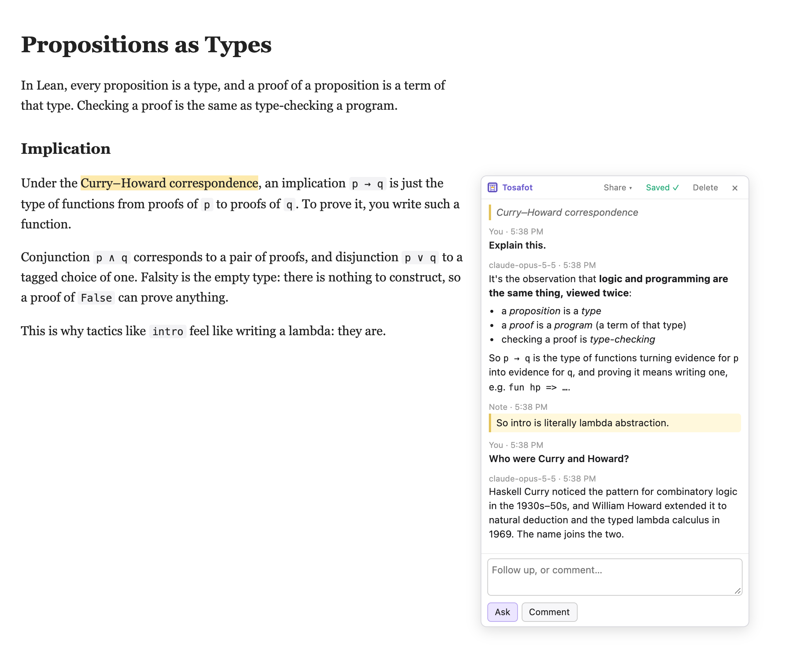
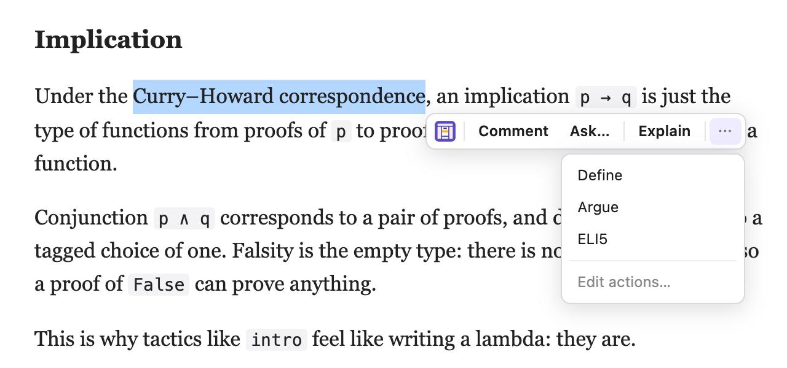

# Tosafot

Select text on any web page, ask an LLM about it, and keep the conversation as a note in the margin. Named for the [*tosafot*](https://en.wikipedia.org/wiki/Tosafot) ("additions"), the medieval commentaries printed in the margins of the Talmud page.

<p><a href="https://github.com/hyperphor/tosafot/releases/latest"></a></p>

Unzip the download, open `chrome://extensions`, turn on **Developer mode**, click **Load unpacked**, and choose the unzipped folder. Then add your Anthropic API key on the settings page that opens. ([Details](#install-from-a-package).)

<p></p>

## Using it



Select text and a small toolbar appears: **Comment** or **Ask…** opens an empty sidenote next to the passage to write in, and prompt buttons like **Explain** (all your prompts are under **⋯**) open one with that question in the box, to edit or just send with Enter. Answers stream into the sidenote. Alt+Shift+A, or the extension's toolbar button, opens an empty sidenote directly. An empty sidenote goes away on Esc or a click elsewhere if you don't use it. See `design/design.md`.

In a sidenote, **Prompts ▾** does the same, and **Save prompt…** keeps whatever is in the box as a new prompt in your menus. Prompts are configurable on the settings page: each has a name, the question it asks (shown in the thread), optional extra instructions to the model (sent with the question but not shown), whether it's on (in the menus), and whether it's also a toolbar button. A library of built-ins (Argue, Steelman, Find the flaw, Quiz me, …) starts mostly off. Hover over an answer to copy it as Markdown.

Each note is a thread. Type in the box at its bottom: **Enter** asks a follow-up (the model sees the whole thread), **⌘/Ctrl+Enter** adds your own comment without calling the model. Comments are passed to the model as notes on later asks, and you can fix one later with the **edit** button next to its time. A note can also start as a comment: from the toolbar's **Comment**, Enter comments instead of asking until you've written the first one. **Stop** cancels a streaming answer.

**Share**, in the note's header, copies the thread as Markdown or opens a post to X, Bluesky, or Mastodon with the quoted passage, your comments (or, if there are none, the first answer), and the page's title and link. Mastodon goes through [share.joinmastodon.org](https://share.joinmastodon.org), which asks which server you use.

**Export to notebook** (the name is configurable), also in the Share menu, adds the note to an Obsidian, Logseq, or other Markdown-based notebook. It appears once you've chosen the notebook's daily notes folder in settings (for a Logseq graph, choose the graph folder; its `journals/` is used) and set a tag. The note goes in as an outline block at the end of the latest note there (by file name), headed by the page's link and the tag (`#tosafot` by default). The quote, your questions, and your comments are child blocks, and answers sit under an `#AskClaude` block, as the logseq-claude plugin does. The block carries an `id::`, so exporting again updates it where it is. Chrome may ask you to allow access to the folder again after a restart; settings has a button for that. **Brave** turns off the folder picker this uses: open `brave://flags/#file-system-access-api`, set "File System Access API" to Enabled, and relaunch.

A note is saved as soon as it has a question or comment in it; one you open and leave empty is discarded. Saved notes are stored in the extension and come back when you revisit the page, opened beside their text (in the page margin when there's room), or wherever you last dragged them. A note that ends with a comment shrinks to just the comment once you click away; hover over it to see the whole note. A note you close stays closed on later visits, its text highlighted with a dotted underline; clicking the highlight reopens it. (Settings can turn off opening notes on load.) If the text a note was attached to is no longer on the page, a badge in the bottom-right corner lists it. **Delete** removes a saved note.

<br clear="right">

Status: version 0.9.0. Milestone 3 (saved notes, re-anchoring, orphan list), plus the selection toolbar, editable and savable prompts, comment editing, sharing, and notebook export.

## Install from a package

Unzip `tosafot-<version>.zip` somewhere permanent, go to `chrome://extensions`, turn on Developer mode, click **Load unpacked**, and choose the unzipped folder. Chrome 105 or later. To upgrade, unzip the new version over the same folder and click reload on the extension card. Keep the folder where it is: an unpacked extension's ID, and so its saved notes, is tied to its path. Removing the extension deletes its notes.

The package is for a fresh install or another machine. If you build from source, keep loading `ext/` instead: a second copy loaded from another folder is a separate extension with its own (empty) notes, and running both doubles every toolbar and sidenote.

## Build

Requires Node and a JDK (for shadow-cljs), and a checkout of [tunamelt](https://github.com/hyperphor/tunamelt) (Hyperphor's persistence library) next to this repo (`../tunamelt`), which provides storage. Babashka is optional.

```sh
npm install
bb build          # or: npm run build
```

Then go to `chrome://extensions`, turn on Developer mode, click **Load unpacked**, and choose `ext/`. The settings page opens on first install; add an Anthropic API key there.

Rebuild after changes and click reload on the extension card. Builds are release-only, since MV3's CSP blocks shadow-cljs's dev-mode loader.

```sh
bb package        # build, then write dist/tosafot-<version>.zip
bb icons          # re-render ext/icons/*.png from assets/*.svg (needs rsvg-convert)
node dev/screenshots.mjs   # re-render assets/screenshots/ from the built extension
node dev/store-shots.mjs   # Chrome Web Store images into assets/store/ (real pages and answers: needs ANTHROPIC_API_KEY)
```

The version lives in both `ext/manifest.json` and `package.json`; `bb package` refuses to run if they differ.

## Providers

Configured on the options page. Two API styles:

- **Anthropic**: Messages API, streamed. Defaults to `claude-opus-5-5` at `low` effort for quick answers. Server-side refusal fallback (`fallbacks: "default"`) is enabled for models that support it.
- **OpenAI-compatible**: any `/chat/completions` endpoint (OpenAI, OpenRouter, Ollama at `http://localhost:11434/v1`, …). The API key is optional.

Keys are stored in `chrome.storage.local`. Requests go from the extension's service worker directly to the provider; there is no backend. See [PRIVACY.md](PRIVACY.md) for exactly what is sent.

## Tests

```sh
bb test           # unit tests (core, llm) under node
bb e2e            # build, then drive the extension in headless Chrome for Testing against a mock SSE server
EXT_DIR=path node dev/e2e.mjs   # same, against another unpacked copy (e.g. an unzipped package)
```

## Layout

| Path | What |
|---|---|
| `src/tosafot/core.cljc` | annotation/thread data model, actions library, prompt construction |
| `src/tosafot/llm.cljs` | provider adapters, fetch + SSE streaming |
| `src/tosafot/ui.cljs`, `dom.cljs` | selection toolbar and sidenote components (shadow DOM) |
| `src/tosafot/pkg.cljc`, `files.cljs` | Export to notebook: note → outline block, placement; the folder handle |
| `src/tosafot/anchor.cljc` | text-quote/position selectors and re-anchoring |
| `src/tosafot/config.cljs` | settings storage |
| `src/tosafot/ext/` | extension entry points: content script, service worker, options page |
| `ext/` | unpacked extension (manifest, options.html, icons, built `js/`) |
| `assets/` | icon sources (`icon.svg`; `icon-small.svg` is a simplified 16 px version), download button, README screenshots, `store/` images |
| `dev/e2e.mjs` | end-to-end test |
| `PRIVACY.md` | privacy policy |
| `design/store-listing.md` | Chrome Web Store listing text, permission justifications, data disclosures |
