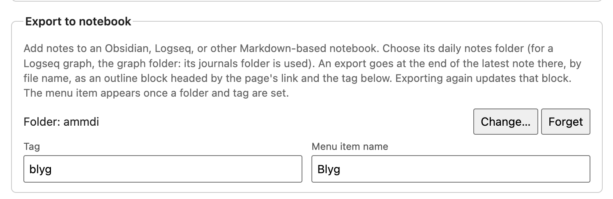

# How to use Tosafot with Blygger

 [Blygger](https://blygger.org) is a new blogging protocol. Tosafot can post items to Blygger via a Personal Knowledge Graph.
 
# Setup

## Have a Markdown-based Digitial Garden aka Personal Knowledge Graph

Obsidian, Logseq, Tine all work. I recommend TIne.

## Setup ThirdMind

TBD

## Setup Tosafot

In the Tosafot configuration view (accessible from the ... menu on the popup via "Edit prompts"). Point Tosafot to your PKG directory and configure the commands:

